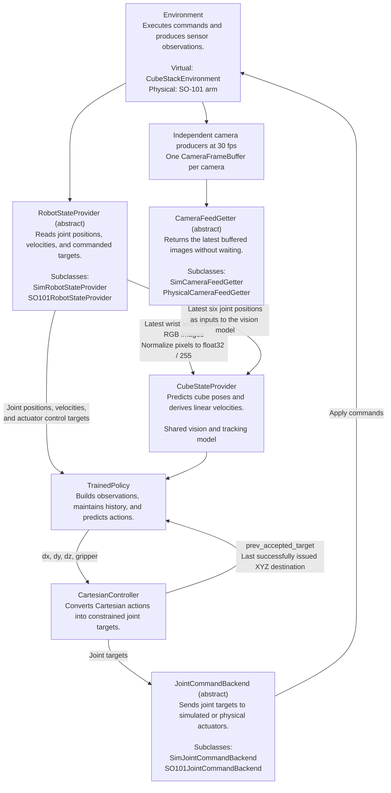

# Shared Simulation and Physical Robot Inference Plan

Status: the shared simulation runtime, models, strict JSON configuration,
supervised trainers, and vision/action data generators are implemented.
Tests cover the component contracts and the combined simulation loop. Real robot
calibration/connection mapping and deployment accuracy remain to be established.
The behavior below is the implementation contract.

## Overview

Use the same cube-perception model, trained policy, and Cartesian controller in
simulation and on the physical SO-101. Separate implementations provide robot
telemetry, camera frames, and joint-command execution.

The cube-perception model takes the latest wrist image, latest external-camera
image, and latest robot joint positions as inputs. It learns to predict cube
positions and orientations directly in robot-base coordinates from a large,
varied synthetic dataset.
Camera setup parameters are used to generate training images, not supplied as
runtime inputs to the perception model.

The `Environment` box represents the shared simulator or physical robot
connection, rather than another abstract class. Its creation and connection
lifecycle stay outside these components.

| Component | Implementations |
|---|---|
| `CubeStackEnvironment` | One shared owner of the MuJoCo simulation |
| `RobotStateProvider` | `SimRobotStateProvider`, `SO101RobotStateProvider` |
| `CameraFrameBuffer` | One shared buffer and failure contract per camera |
| `CameraFeedGetter` | `SimCameraFeedGetter`, `PhysicalCameraFeedGetter` |
| `CubeStateProvider` | One shared vision and tracking implementation |
| `TrainedPolicy` | One shared observation, history, and policy implementation |
| `CartesianController` | One shared controller using matching robot geometry |
| `JointCommandBackend` | `SimJointCommandBackend`, `SO101JointCommandBackend` |
| `LoopRunner` | One shared control-loop coordinator |

The two camera-provider implementations describe where images come from. Each
can supply both wrist and external-camera views.

## Source and test layout

Runtime modules live directly in `src/`, without a `robot_arm/` package folder.
Put all schemas under the `src/schemas/` package: configuration schemas, shared
state/command records, array aliases, and any additional schemas needed during
implementation. Replace the existing single schemas module with this package
when implementing; its `__init__.py` can export the shared names used by callers.
Use unconditional runtime imports. For entry-point scripts outside `src/`, use
`PYTHONPATH=src` when launching them.

The layout includes one JSON configuration file initially:

```text
configs/
    default.json          # Explicit configuration values for the project
src/
    schemas/
        __init__.py
        config.py         # Pydantic root configuration and nested subconfigs
        state.py          # Robot, camera, and cube state records
        commands.py       # Command and control-step records
        arrays.py         # Shared array aliases and observation layout
    ...                   # Runtime components
scripts/
tests/
```

This layout is implemented. Entry points for vision/action data generation, vision and
action training, and the shared simulation loop live in `scripts/`; usage and
tensor file formats are documented in `README.md`.

Root `pytest.ini` sets `testpaths = tests` and `pythonpath = src`. The active
suite lives in `tests/`; `legacy/` is excluded from automatic collection and
remains a reference for the previous implementation.

`legacy/` may contain relevant logic for the new implementation. Consult it as
background when useful, but recreate any reused logic in the active project
code. Do not import, execute, or otherwise depend on files inside `legacy/`.
Keep this plan's legacy references at the directory level rather than citing
individual archived files.

## Configuration schemas and explicit training values

Use Pydantic for the JSON configuration schemas, with a root `ProjectConfig`
and typed nested subconfigs rather than unstructured dictionaries. Store schema
definitions in `src/schemas/config.py` and values in `configs/default.json`.
There is no separate Python file containing the project's configuration values.

| Configuration section | Schema | Responsibility |
|---|---|---|
| Root | `ProjectConfig` | Own the complete configuration and required sections |
| `vision_model` | `VisionModelConfig` | External input adapter, pretrained backbone, wrist CNN, and pose MLP settings |
| `action_policy` | `ActionPolicyConfig` | History length, action MLP, inference settings, and transformer subconfig |
| `action_policy.transformer` | `TransformerConfig` | Embedding dimension, layer count, attention heads, feedforward dimension, and dropout |
| `training` | `TrainingConfig` | Typed vision/action training subconfigs for data, optimizer, batching, epochs, seeds, and evaluation settings |
| `training.vision.lr_scheduler` | `ReduceLROnPlateauConfig` or `null` | Optional validation-driven learning-rate decay for vision training |
| `environment` | `EnvironmentConfig` | Scene and configurable episode/data-generation settings |
| `environment.action_data` | `ActionDataGenerationConfig` | Demonstration split, starts, cube sampling, teacher, drop/recovery, and success settings |
| `cameras` | `CameraConfig` | Shared camera settings, including FPS and maximum frame age |
| `cartesian_controller` | `CartesianActionConfig` | Movement scale, gripper commands, and IK settings |
| `loop` | `LoopRunnerConfig` | Control-loop settings |

Add further subconfig schemas under `src/schemas/` when a component needs them.
Keep each setting in one owning section and pass its value to every consumer
that needs it, such as the camera frame-age limit shared by buffers and perception.

All configuration models, including every nested subconfig, must use a shared
Pydantic base with `ConfigDict(extra="forbid", strict=True)`. Reject unknown
fields instead of silently ignoring them, and reject inappropriate type
coercions. Validate the JSON through Pydantic's JSON-aware validation so JSON
representations such as arrays can map to declared tuple fields. Let validation
errors identify the field and propagate before training starts. Pydantic
configuration is inherited through a shared base; nested models need that base
too. See the [Pydantic configuration documentation](https://docs.pydantic.dev/latest/concepts/config/).

Only declare configuration fields that are actually wired into the relevant
component. Unknown-field rejection does not itself detect a declared field
that code never reads; implementation and configuration-wiring tests must cover
that separately.

For training, `configs/default.json` must explicitly supply every configurable
value used by the run, including nested model, optimizer, data-loader, evaluation,
and environment settings. Make these file-backed schema fields required: a
missing field or section must raise an error rather than obtain a default.
Nullable fields must still appear explicitly, using JSON `null` when intended.
Values labeled as defaults elsewhere in this plan are the initial values to
write into the JSON file, not permission to omit those fields.
The optional `training.vision.lr_scheduler` field is a compatibility exception:
older saved checkpoint configs omit it and must remain loadable. Its absence or
explicit `null` disables scheduling; when enabled, all nested fields are required.

Reusable functions and methods may keep code-level defaults. Training scripts
and their helpers must explicitly pass the relevant constructor and function
parameters from the validated configuration, using named arguments or an
explicitly supplied typed subconfig. Do not merge in default configurations,
use fallback getters for missing settings, or silently rely on method defaults
in the training path. Derived values and runtime dependencies such as tensors,
clocks, and robot connections are constructed in code and passed explicitly;
fixed schema contracts such as observation ordering do not become JSON knobs.
The requested action-generation example counts are explicit exceptions:
`NUMBER_OF_TRAINING_EXAMPLES = 5000` and
`NUMBER_OF_VALIDATION_EXAMPLES = 1000` live in
`scripts/generate_action_data.py`, with corresponding `--training-examples` and
`--validation-examples` overrides. The compatible `--examples` option selects
total-count mode using the configured train fraction and cannot be combined with
either split flag. All other action-generation settings come from the validated
project configuration.

Test rejection of extra fields at the root and nested levels, missing settings,
and wrong types, plus wiring of non-default values into the intended components.
These configuration checks do not add value or confidence checks to cube-pose
predictions.

## Architecture



`LoopRunner` coordinates the components in this diagram using `LoopRunnerConfig`,
with a default control frequency of 20 Hz.

## Shared resources and timing

- The simulated robot-state provider, camera provider, and command backend all
  receive references to the same `CubeStackEnvironment` instance. They do not
  create separate simulations or copy state through a separate shared store.
- On hardware, the robot-state provider and command backend share one connected
  LeRobot robot object. The application owns the physical camera connections
  and independent camera-production workers.
- Ordinary Python objects and method calls are sufficient initially; a
  publisher/subscriber framework is not required.
- Providers only read state or retrieve buffered images. Camera production runs
  independently at 30 fps in both simulation and hardware; camera getters never
  read, render, or wait for a new frame. The simulated backend's
  `advance()` method is the sole owner of physics advancement in this design.
- One control iteration represents 50 ms at 20 Hz. That budget
  includes reading sensors, perception, policy inference, IK, and command
  transmission. Wait only for the remainder of the interval, rather than an
  additional 50 ms after sending commands.
- Do not wait for each joint target to be reached before starting the next
  iteration. Read the latest measured state while the robot continues moving.
- The shared loop uses wall-clock pacing in both simulation and hardware.
  Assume computation finishes within the configured interval for now; handling
  overruns is deferred. Simulation advances by one fixed interval per control
  tick, including ticks that retain the previous targets while vision is unavailable.
- Joint ordering, joint directions and offsets, units, and robot geometry must
  match the model's observation and controller conventions. Forward and inverse
  kinematics remain responsible for robot motion; cube perception learns its
  image-to-robot-coordinate mapping.
- Develop simulation first. Hardware calibration remains a future TODO,
  including joint signs and zero offsets, the joint-velocity source, and the
  source of startup commanded targets.
- Retain simulator ground truth for vision-training labels, scripted teacher
  decisions, grasp/recovery logic, and success scoring. Saved action observations
  and policy evaluation inputs come from the trained vision model through the
  shared cube-state provider.
- Resetting policy/controller bookkeeping is separate from resetting simulator
  physics or physically moving the robot to its starting pose.
- Task completion may initially be handled by manual intervention.

## Numerical conventions and observation order

Use the legacy joint order consistently for measured positions, velocities,
actuator targets, and command vectors:

```text
shoulder_pan, shoulder_lift, elbow_flex, wrist_flex, wrist_roll, gripper
```

Joint positions and targets use radians; joint velocities use radians per
second. All Cartesian distances use meters and linear velocities use meters
per second. XYZ values are expressed in the robot-base frame. Quaternions in
legacy action demonstrations and legacy vision labels retain the MuJoCo
`(w, x, y, z)` component order. Current vision inference outputs circular yaw
pairs directly.

The gripper reference point is the rigid MuJoCo site named `gripperframe`, using
its `site_xpos` directly. There is no additional offset. The legacy jaw-midpoint
measurement was a separate diagnostic, not the policy's gripper position or the
Cartesian controller's reference point. Hardware forward kinematics must return
the position of this same site.

Preserve compatibility with the legacy raw observation order with cube angular
velocity and jaw-contact flags removed. Older ground-truth action demonstrations
retain quaternions in this 41-value layout; new vision-based demonstrations save
the 37-value policy observation directly:

| Index range | Values | Count |
|---|---|---|
| `[0:6]` | Joint positions | 6 |
| `[6:12]` | Joint velocities | 6 |
| `[12:18]` | Actuator control targets | 6 |
| `[18:21]` | `gripperframe` XYZ | 3 |
| `[21:24]` | Orange XYZ | 3 |
| `[24:28]` | Orange quaternion `(w, x, y, z)` | 4 |
| `[28:31]` | Orange linear velocity | 3 |
| `[31:34]` | Blue XYZ | 3 |
| `[34:38]` | Blue quaternion `(w, x, y, z)` | 4 |
| `[38:41]` | Blue linear velocity | 3 |
| `[0:41]` | **Raw observation total** | **41** |

Shared conversion replaces each four-value quaternion in legacy action data or
legacy vision labels with `cos(4θ), sin(4θ)`. The action observation then has 37
values. The factor of four makes yaw rotations separated by 90° equivalent for
an unmarked cube. Normalize the quaternion and select the cube axis with the largest absolute Z
component. Choose the upward sign of that face normal and apply the smallest
rotation taking that normal to world +Z. Measure an in-plane cube
edge's yaw after this leveling rotation to obtain θ.

If vertical scores tie within `1e-6`, retain the previously selected face when
it is among the tied candidates. Associate that face by its world-space normal
to preserve equivalence under quaternion sign changes and cube-face relabeling.
Use a deterministic world-space geometric tie-break when no previous face is
available. A clearly better face wins immediately. Positive θ is
counterclockwise about world +Z when viewed from above. Remove the previous
5% face-switch hysteresis and `action_policy.cube_yaw` configuration.

Maintain independent label encoders for both cubes, reset for each generated
sequence or saved episode. Vision generation updates them at every control
tick, including frames not selected for saving. Legacy vision shards can only
update them in their saved sample order; unsaved history cannot be recovered.
The per-frame vision model learns these labels, but its inputs do not include
the previous selected face, so it cannot itself enforce the temporal tie rule.

Current vision outputs each cube's XYZ and two yaw components directly. Normalize
the predicted pair with a `1e-6` denominator floor at the perception boundary and include it in
the policy observation without reconstructing a quaternion. Dataset loading
preserves new 37-value rows and converts legacy raw action episodes before
constructing overlapping windows; each
timestamp has the same features wherever it occurs. Temporal policy history
remains independent of this label-creation state; runtime perception supplies
the learned yaw pair directly.

The processed action-policy history token is ordered as follows:

| Index range | Values | Count |
|---|---|---|
| `[0:21]` | Joint positions, velocities, control targets, and `gripperframe` XYZ, as above | 21 |
| `[21:24]` | Orange XYZ | 3 |
| `[24:26]` | Orange `cos(4θ), sin(4θ)` | 2 |
| `[26:29]` | Orange linear velocity | 3 |
| `[29:32]` | Blue XYZ | 3 |
| `[32:34]` | Blue `cos(4θ), sin(4θ)` | 2 |
| `[34:37]` | Blue linear velocity | 3 |
| `[0:37]` | **Policy observation subtotal** | **37** |
| `[37:41]` | Previous action `[dx, dy, dz, gripper]` | 4 |
| `[41:44]` | Previous accepted XYZ target (`prev_accepted_target`) | 3 |
| `[0:44]` | **Total per history token** | **44** |

Each legacy raw observation has 41 values; its processed policy observation has
37. New action demonstrations save those 37 policy features directly.
Each history token has 44 values: the processed observation, the previous
normalized `[dx, dy, dz, gripper]` action, and `prev_accepted_target`.
Convert model inputs to `float32`; simulation state and
kinematic calculations can retain MuJoCo's `float64` precision. Padding and
episode-start masks remain separate from these numerical features.

The cube-vision model predicts positions and circular yaw pairs only.
`CubeStateProvider` calculates cube linear velocities from successive position
estimates and includes those derived values in the action-policy observation.
They are not additional outputs of the vision network. The action policy keeps
up to 384 history tokens; using the latest sensor readings for each observation
does not remove this policy history.

## Scene cameras

The scene contains `wrist_cam` and `external`, mapped to the provider identifiers
`"wrist"` and `"external"`. There is no `overhead` camera.

The perspective `external` camera is at `(0.43, 0.23, 0.20)` meters, inset 2 cm
from the positive X and Y walls. The camera remains 20 cm above the floor, while
the walls are 50 cm tall. The enclosure is bounded by X `[-0.05, 0.45]` and
Y `[-0.25, 0.25]` meters. The camera retains its viewing
direction proportional to `(-0.25, -0.25, -0.20)`: about 29.50 degrees downward
from horizontal, along the inward diagonal. Its central ray now intersects the
floor at `(0.18, -0.02, 0.00)` meters. Its vertical field of view remains 90 degrees.

## Learned cube-state estimation

One shared vision model predicts cube poses directly from the latest two camera
views and latest robot joint positions. It learns the relationship between image
appearance, arm configuration, and robot-relative cube locations from training
examples.

```text
Latest wrist RGB image + latest external RGB image + latest six joint positions
    -> Convert RGB pixels from uint8 [0, 255] to float32 [0, 1] by dividing by 255
    -> Shared vision model
    -> Cube XYZ positions and circular yaw pairs in robot-base coordinates
    -> Tracking across observations to estimate cube linear velocities
```

For each combined estimate, use the latest available reading from each camera
and the latest robot-state snapshot. This is a simple latest-sample
approximation: the readings may describe different capture times. Do not match
timestamps or interpolate joint readings for now. Preserve the original sensor
timestamps, including camera capture times used for the one-second age check.
Each combined estimate uses the loop-supplied `current_time`, taken from the
latest robot state's timestamp in the common session clock, as its
observation/estimate reference time; this does not imply
synchronized capture, and it is not an average of the frame timestamps.

The vision inputs are wrist RGB, external RGB, and the six joint positions in
the order defined above. Joint velocities and commanded targets are policy
inputs, not vision inputs. Keep buffered images as raw `uint8` RGB; at the vision
model boundary, create `float32` image inputs and divide by `255.0` without
mutating the frame buffers. Convert joint inputs to `float32` without applying
pixel normalization to them. Its pose predictions already use robot-base
coordinates. The model uses an external-camera input-convolution adapter and
ImageNet-pretrained ResNet-34, a separate small wrist-camera CNN, and a pose MLP.
All parameters are trainable, as described below.

### Vision model tensor interface

Use three separate input tensors and one pose-output tensor:

| Tensor | Shape | Dtype and convention |
|---|---|---|
| Wrist image | `[batch, 3, 128, 128]` | `float32`, RGB channels first, pixels in `[0, 1]` |
| External image | `[batch, 3, 300, 300]` | `float32`, RGB channels first, pixels in `[0, 1]` |
| Joint positions | `[batch, 6]` | `float32`, radians, in `ROBOT_JOINT_NAMES` order |
| Output poses | `[batch, 10]` | `float32`, orange XYZ/yaw pair followed by blue XYZ/yaw pair, as ordered below |

The provider converts buffered wrist images from `(128, 128, 3)` and external
images from `(300, 300, 3)` to channels-first layout at the model boundary,
without changing the raw frame. All three inputs
share the batch dimension: each row contains the latest samples for one combined
observation. Runtime inference uses `batch = 1`; training can batch multiple
observations. Neither input image tensor includes a temporal/history dimension.

### Vision model architecture and configuration

Encode the external image with the input-convolution adapter and one
ImageNet-pretrained ResNet-34 instance. Encode the wrist image with a separate
small CNN. Concatenate their feature vectors with joint positions in a fixed order.

| Stage | Input shape | Output shape | Training behavior |
|---|---|---|---|
| External input-convolution adapter and bilinear resize | `[batch, 3, 300, 300]` | `[batch, 3, 224, 224]` | Trainable adapter, fixed resize |
| ResNet input normalization | `[batch, 3, 224, 224]` | `[batch, 3, 224, 224]` | Fixed preprocessing |
| Pretrained ResNet-34 through global average pooling | `[batch, 3, 224, 224]` | `[batch, 512]` | All weights fine-tuned |
| Wrist CNN: two stride-2 convolutions, 16 channels each, and ReLU | `[batch, 3, 128, 128]` | `[batch, 16, 32, 32]` | Trainable |
| Wrist adaptive average pooling, flatten, and linear projection | `[batch, 16, 32, 32]` | `[batch, 128]` | Trainable projection |
| Concatenate wrist features, external features, and six joint positions | `[batch, 128]`, `[batch, 512]`, `[batch, 6]` | `[batch, 646]` | No parameters |
| Pose MLP | `[batch, 646]` | `[batch, 10]` | Trainable |

Remove ResNet's original ImageNet classification layer and use its pooled
512-value features, not its classification logits. Keep the raw image and
model-boundary conventions above: divide RGB pixels by `255.0` before the
trainable adapter or wrist CNN. Inside the external encoder, apply the pretrained ResNet's channel
normalization before the backbone: RGB mean `(0.485, 0.456, 0.406)` and standard
deviation `(0.229, 0.224, 0.225)`. Use the same preprocessing during training and
inference. The external adapter uses a 3×3, stride-1 convolution with padding to
preserve the 300×300 input dimensions and identity initialization, then bilinear
resizing to 224×224. Each wrist convolution uses a 3×3 kernel, stride 2, padding 1, and
ReLU. Adaptive pooling produces a 4×4 grid, flattened to 256 values with the
default 16 output channels, before a linear projection to 128 features.

The default pose MLP has one hidden layer:

```text
646 inputs -> Linear(646, 2048) -> ReLU -> Dropout(0.1) -> Linear(2048, 10)
```

The Pydantic `VisionModelConfig` subconfig lives under `src/schemas/`. These
initial values are explicitly provided in the `vision_model` section of
`configs/default.json`:

| Field | Type | Initial JSON value | Meaning |
|---|---|---|---|
| `adapter_kernel_size` | `int` | `3` | Positive odd kernel size for the external-camera input adapter |
| `backbone_weights` | `str` or `null` | `"IMAGENET1K_V1"` | ResNet-34 ImageNet initialization; `null` starts without pretrained weights |
| `wrist_cnn.layers` | `int` | `2` | Number of wrist convolution layers, at least one |
| `wrist_cnn.channels` | `list[int]` | `[16, 16]` | Positive output channel count for each convolution; length must equal `layers` |
| `wrist_cnn.embedding_dim` | `int` | `128` | Positive size of the wrist embedding concatenated with external features and joints |
| `mlp_hidden_layers` | `int` | `1` | Number of hidden linear layers, excluding the final 10-value output layer |
| `mlp_hidden_dim` | `int` | `2048` | Width of each hidden layer |
| `dropout` | `float` | `0.1` | Fraction of hidden activations dropped during training, in `[0, 1)` |

Apply ReLU and then dropout after each hidden layer; leave the final pose-output
layer linear. Disable dropout during validation and inference with evaluation mode.
These settings configure the cube-vision MLP, independently of the action
policy's transformer and MLP. The configuration file and model implement these
settings; their strict schemas live under `src/schemas/`.

During vision training, update the external input-convolution adapter, every
ResNet-34 parameter, the wrist CNN, and the pose MLP. ResNet's BatchNorm layers
follow the model's train/eval mode: update running statistics during training
and use them unchanged during validation and inference. Inference can disable
gradient tracking for the entire model. Older shared ResNet-50 checkpoints are
incompatible with this architecture and require new training.

### Vision model output

The pose output contains **10 values**, calculated as
`2 cubes × (3 position values + 2 yaw values)`. Position and orientation
sections are concatenated; their dimensions are added rather than multiplied.

| Index range | Output section | Dimensions |
|---|---|---|
| `[0:3]` | Orange cube XYZ position | 3 |
| `[3:5]` | Orange cube `cos(4θ), sin(4θ)` | 2 |
| `[5:8]` | Blue cube XYZ position | 3 |
| `[8:10]` | Blue cube `cos(4θ), sin(4θ)` | 2 |
| `[0:10]` | **Total pose output** | **10** |

Positions use meters in robot-base coordinates. The vision network does not
predict linear velocity. The provider derives it separately for the policy
using successive position estimates and their positive time differences, as
described in the `CubeStateProvider` interface below.

Train and evaluate with the same weighted pose loss, averaged over cubes and
examples: `200 * XYZ_MSE + 1 * yaw_pair_MSE` by default, with both weights
explicitly passed from `training.vision`. Normalize predicted and target yaw
pairs, then average squared error over their two components. For unit pairs,
this is `1 - cos(4 * (predicted_yaw - target_yaw))`; angles separated by 90°
match, and 89.9° is close to 0.01° across the wrap boundary. These uniformly
colored, unmarked cubes have equivalent quarter-turn headings; distinct face
markings would require reconsidering this symmetry assumption. The validation
loss-breakdown diagnostic uses the same calculation.

New vision datasets save `[N, 10]` pose labels with
`pose_representation: "leveled_yaw_cos4_sin4_previous_face_ties"`. The loader also
accepts existing `[N, 14]` quaternion labels, converting them in memory in saved
sample order with the same most-horizontal-face rule and previous-face tie
choice. Compatible existing camera images need no
regeneration. Vision checkpoint format is version 3: versions 1 and 2 have
incompatible quaternion heads and must be retrained. Their quaternion-loss
metrics are not directly comparable to the circular yaw loss.

Use batch size 16 for vision training. Configure validation-driven learning-rate
decay under `training.vision.lr_scheduler`: `type: "reduce_on_plateau"`,
`factor: 0.5`, `patience: 1`, relative `threshold: 0.001`, and `min_lr: 0.000001`.
Start from `training.vision.learning_rate: 0.0001`. Step the scheduler only after
a new weighted validation loss is calculated, including the final epoch.
PyTorch patience counts validation checks: tolerate one check without a
qualifying improvement, then halve the rate after the second consecutive such
check. The improvement must exceed 0.1% relative to the scheduler's best loss.
With checks every 10 epochs, the two-check plateau normally spans 20 epochs
after the last qualifying improvement. Never decrease below the configured
minimum, which must not exceed the initial learning rate. Set the scheduler to
`null` for a constant rate; missing scheduler settings in older configs also
disable it. Keep action training unchanged.

During each scheduled vision validation pass, also report the mean Euclidean
position error in meters: compute each cube's 3-D position distance, average
the two distances per example, then average over all validation examples.
Reuse the validation predictions; do not weight or square these distances.
Log this as `val_position_error_m` beside `epoch`, `train_loss`, and `val_loss`,
using `NaN` at epoch 0 and on epochs without validation. The progress bar retains
the latest measured validation metrics between checks.
Also log `learning_rate` for the rate used during the completed epoch and
`next_learning_rate` for the rate after any scheduler update. Both equal the
initial learning rate at epoch 0; a reduction affects training from the next
epoch onward.

Use the same guarded normalization for runtime action inputs: divide each yaw
pair by `max(norm, 1e-6)`. Nondegenerate pairs have unit length; exactly zero pairs
remain zero. Do not add
numeric-range or plausibility checks, confidence thresholds, or per-cube
validity flags. The model returns both cube poses; it does not report missing
detections. Missing sensor inputs and camera freshness remain governed by the
existing input-availability and camera-timeout rules.

### Perception training data

- Generate a large dataset spanning different wrist-camera mounting positions
  and angles, external-camera positions and angles, focal lengths, fields of
  view, and lens distortion.
- Vary lighting, shadows, backgrounds, textures, exposure, image noise, blur,
  and partial occlusion to cover varied visual conditions.
- Include varied arm configurations and cube positions and orientations during
  approaching, grasping, carrying, dropping, recovering, and stacking.
- Independently select each sequence's mode: 30% ground, 10% stacked, and 60%
  task. Exclude standalone elevated and carry modes from the default mix.
  Task mode retains pickup, carrying, intentional dropping, recovery, and
  attempted stacking during the sequence's 45 simulated seconds.
- The separate `scripts/generate_vision_uniform_data.py` samples uniform
  gripper-frame targets from the existing vision spawn X/Y bounds and Z=3–8 cm.
  It retains a physical orange grasp between successful samples, resamples blue
  and both cameras per attempt, and saves one UUID `.pt` example with simulator
  labels. Surface/light/texture variation uses the existing per-scene setup.
  Errors recreate the scene before the next target; a split boundary also
  creates a fresh scene. It counts successful saves (default 5000), uses the
  existing train fraction, and logs UUIDs/failures as JSON lines independently
  of tqdm. Camera resampling restores original mounts/intrinsics each time.
- At each sampled observation time, synchronously render the wrist and external
  cameras from the same frozen simulation state, capturing and saving wrist RGB
  at 128×128 and external RGB at 300×300. Save matching joint positions
  and exact cube poses in robot-base coordinates, with the same simulation
  timestamp for the robot and both camera views. Offline generation uses no
  camera worker, frame buffer, startup polling, or frame-age timeout. Runtime
  inference retains its independent camera production and latest-sample
  convention. Apply the same `float32 / 255.0` pixel normalization at the model
  boundary. Use temporal sequences for tracking and linear-velocity estimation.
- During generation, preselect `environment.vision_data.samples_per_sequence`
  distinct observation times per rollout (default 5), randomly without
  replacement from the candidate steps defined by `sample_interval_steps`.
  Use the rollout's random seed and collect only those observations in temporal
  order, preserving the full rollout duration and control updates. Save aligned
  images from both cameras, joints, labels, timestamps, and per-sample metadata.
  Reject rollouts with fewer candidate times than the requested count.
  Apply the same count to both training and validation sequences. Training,
  validation, and diagnostic loaders use every saved row without subsampling,
  resizing, or upsampling, and reject mismatched per-camera image dimensions;
  training still shuffles order each epoch. Existing files remain unchanged.
  Regenerate datasets containing 128×128 external images before using them with
  the updated loaders, and restart existing generator processes to load the new
  capture sizes.
- Preserve the 20 Hz control cadence in simulation time: advance physics by
  0.05 seconds after each command for all 900 steps of a default 45-second
  rollout. Remove wall-clock pacing sleeps and render only at the selected
  observations, retaining the configured focus and motion-blur rendering passes.
  Wall-clock duration depends on computation and file writing and can be shorter
  or longer than the simulated duration.
- Sample camera setups across examples or sequences. Within a sequence, keep
  mounts and lens settings consistent while the wrist camera follows the arm,
  matching ordinary operation on the physical robot.
- The shared `camera_position_jitter` supplies X/Y/Z bounds in meters:
  `[0.01, 0.01, 0.01]` gives both camera mounts uniform offsets of ±1 cm on each
  parent-body axis, sampled once per sequence.
- Both cameras independently sample vertical FOV from `fov_range: [65.0, 100.0]`
  once per sequence. Cameras with explicit sensor intrinsics also scale their
  focal lengths to realize that FOV, preserving sensor size, focal-length ratio,
  and principal point. This includes the arm-mounted wrist camera.
- Sample per-camera white-balance RGB gains `[0.9, 1.1]`, gamma `[0.9, 1.1]`,
  focus distance `[0.15, 0.6]` meters, and shutter duration `[0.002, 0.012]`
  seconds once per sequence, and record them in `camera_setup`. Apply these to
  both views. Gamma uses normalized `output = input ** gamma`.
- Approximate defocus from each rendered metric depth map using inverse-distance
  error, with `focus_blur_scale: 0.6` and `focus_blur_max_sigma: 2.0` pixels.
  This is depth-dependent Gaussian softness, not aperture/bokeh simulation.
- With `motion_blur_probability: 0.25`, average `motion_blur_samples: 3` poses
  over the short shutter interval ending at the frame timestamp. Use copied
  simulation data and constant-velocity integration, including the wrist mount,
  with matching focus depth at every sample. Never advance live physics or alter
  labels. Skip temporal sampling for static scenes or zero exposure, and clip
  exposures at simulation time zero. Zero focus strength or motion probability
  disables the respective effects. These effects add rendering cost.
- `light_position_jitter: [0.1, 0.1, 0.1]` varies the overhead light's X/Y/Z
  position by ±10 cm around `(0, 0, 1.524)` meters (5 ft above the tabletop).
  It is a positioned spotlight that stays
  aimed at the enclosed tabletop's center `(0.20, 0, 0)` after each offset,
  so these offsets affect lighting and shadows.
- Sample ambient brightness independently from `[0.2, 0.8]`. Keep light hues
  varied but near white with saturation `[0.0, 0.08]`, and enable scene-light
  shadows through `shadows_enabled`. These values live in `environment.vision_data`.
- Sample surface settings once per sequence with Gaussian rejection sampling.
  Under `environment.vision_data`, each of `specular`, `shininess`, and
  `reflectance` has four fields ending in `_mean`, `_variance`, `_min`, and
  `_max`. Specular and shininess default to `0.65`, `0.55`, `0.1`, and `0.8`,
  respectively; reflectance defaults to `0.2`, `0.33`, `0`, and `0.7`.
  `draw_clipped_val_from_gaussian` converts variance to standard deviation with
  a square root and redraws out-of-range values instead of clamping them.
  Independently randomize specular and shininess for existing named arm
  materials; geoms sharing a material change together. During generator model
  construction, create seven materials in memory for the two cubes, four walls,
  and table, sampling all three properties independently for each. Preserve
  source XML files, physics, colors, and the normal runtime environment.
  Record samples in `camera_setup["materials"]`; only newly generated images
  receive them. Native mirror reflectance is limited to the first eligible
  geom, the table in this scene, even though all seven materials receive values.
- Train the model on these varied setups, then evaluate on held-out camera
  setups and real images. Measure cube-pose error and downstream stacking
  success to assess how well the learned mapping generalizes.

Simulator camera parameters belong to data generation. The runtime camera
provider supplies images, camera identifiers, and timestamps; the cube-state
provider uses those images and joint angles without per-camera geometry inputs.

## Common schemas

These names describe shared data records and array types under `src/schemas/`,
rather than additional runtime components. Any further schema definitions also
belong in that package; Pydantic configuration schemas share this location with
the runtime records and array aliases.

| Type | Contents |
|---|---|
| `Vec3` | Floating-point NumPy array, shape `(3,)`. |
| `JointVector` | Floating-point NumPy array, shape `(6,)`, in the joint order defined above. |
| `PolicyAction` | `np.ndarray`, shape `(4,)`: normalized `[dx, dy, dz, gripper]`. |
| `RobotState` | Timestamp, joint positions, joint velocities, commanded joint targets, and gripper XYZ. |
| `CameraFrame` | Camera identifier, capture timestamp, and `uint8` RGB `np.ndarray` with shape `(128, 128, 3)` for wrist or `(300, 300, 3)` for external. Incoming images already have their camera's size; frame buffers preserve their resolution. |
| `CameraFrames` | `dict[str, CameraFrame]`, typically containing `"wrist"` and `"external"`. |
| `CubeState` | Combined observation/estimate reference timestamp supplied as `current_time`, XYZ position, circular yaw pair, and linear velocity relative to the robot base. Runtime has no quaternion (`orientation=None`); simulator-only raw action recording retains a quaternion. This timestamp does not imply synchronized sensor capture. |
| `CubeStates` | `dict[str, CubeState]`, containing `"orange"` and `"blue"`. |
| `PlannedCommand` | Joint targets, proposed accepted Cartesian target, and IK diagnostics. |
| `CommandReceipt` | Timestamp and the actual joint targets sent to the actuators. Successful transmission does not mean those positions have been reached. |
| `StepResult` | Input states, predicted action, planned command, and command receipt for one iteration. |

Providers convert values into the agreed units and coordinate conventions. All
timestamps within a session use a common clock: simulation time or the hardware
session's monotonic clock. Frame age compares a capture timestamp with current
time from this same clock. Camera read-failure durations use the buffer's
monotonic clock independently of simulation time.

## CubeStackEnvironment

Owns the shared MuJoCo model and mutable simulation state. This is a new concrete
class in `src/environment.py`, not an import from `legacy/`. Simulated state and
camera providers and the command backend receive the same instance.

Fields:

- `scene_path: Path` — scene XML location; default `DEFAULT_SCENE_PATH` points to
  the active `scenes/so101_two_cube_stack.xml`.
- `model: mujoco.MjModel` — loaded scene and robot geometry.
- `data: mujoco.MjData` — simulation state and actuator controls.
- `state_lock: LockType` — shared lock for physical state updates and sensor
  snapshots.

`DEFAULT_GRIPPER_POSITION = 1.0` in `src/robot_constants.py` defines the initial
gripper joint position and actuator control target.

| Method | Inputs and types | Return type | Docstring / description |
|---|---|---|---|
| `__init__` | `scene_path: Path \| str = DEFAULT_SCENE_PATH` | `None` | Own the model and data for the requested scene. Providers must share this object instead of independently loading simulations. |
| `reset` | None | `None` | Restore the scene XML's initial arm state and initialization bookkeeping, then set the gripper's joint position and actuator control target to `DEFAULT_GRIPPER_POSITION` (`1.0`). Refresh forward kinematics without stepping physics or advancing simulated time. This is separate from resetting policy history. |

There is no environment physics-step method in this interface.
`SimJointCommandBackend.advance()` alone owns simulation advancement. A control
interval must be an integer multiple of the scene's physics timestep; the
default 20 Hz interval satisfies this.

The application coordinates reset with simulation camera production and command
advancement using a shared lock. When resetting the simulation clock, it also
resets all camera buffers so frames from the previous episode cannot be reused.

## RobotStateProvider (abstract)

Supplies a snapshot of the robot's current state. Implementations are
`SimRobotStateProvider` and `SO101RobotStateProvider`.

Fields:

- No required storage fields. Each implementation retains its simulator or
  hardware reference internally.

| Method | Inputs and types | Return type | Docstring / description |
|---|---|---|---|
| `read` | None | `RobotState` | Read current joint positions, velocities, commanded targets, and gripper position. Return an independent, timestamped snapshot using the joint order and units above. Gripper position is the `gripperframe` site position, measured by the simulator or computed by matching hardware forward kinematics, without an extra offset. Reading must not move the robot or advance simulation. |

## CameraFrameBuffer

Stores the latest frame and camera health for one camera. Simulated and physical
camera producers use the same contract. Producer updates and getter access must
be synchronized so callers see a coherent frame and failure state.

Fields:

- `camera_id: str` — identifier of this buffer's camera.
- `latest_frame: CameraFrame | None` — most recent successfully produced frame.
- `last_camera_read_failure: float | None` — monotonic time of the first failed
  read in the ongoing failure streak, despite the field's name; `None` after a
  successful read or reset.
- `failure: RuntimeError | None` — latched fatal camera failure,
  preserved until reset and re-raised by getters.
- `maximum_frame_age_seconds: float = 1.0` — maximum frame age and maximum
  continuous camera-read failure duration, in seconds.
- `clock: Callable[[], float]` — monotonic clock for read-failure durations;
  defaults to `time.monotonic`.
- `lock: LockType` — synchronizes producer publication and consumer snapshots.

| Method | Inputs and types | Return type | Docstring / description |
|---|---|---|---|
| `__init__` | `camera_id: str`<br/>`maximum_frame_age_seconds: float = 1.0`<br/>`clock: Callable[[], float] = time.monotonic` | `None` | Store the camera identifier, timeout, and monotonic clock. Initialize an empty frame, no failure streak, and no latched failure. |
| `reset` | None | `None` | Clear the latest frame, first failed-read timestamp, and latched failure for a new session or episode. |
| `record_read` | `success: bool`<br/>`frame: CameraFrame \| None` | `None` | Record a producer read result. The first `False` starts the failure timer; later `False` results preserve its start time. A successful read supplies a frame, clears the timer, and overwrites the latest frame. Check the elapsed failure duration before accepting recovery: once it exceeds the limit, latch a fatal `StaleVisionDataError` even if no getter polled during that interval. A successful read cannot clear a latched fatal failure. |
| `get_latest` | `current_time: float` | `CameraFrame` | Immediately return the latest frame using the common sensor/session clock to check its age. Check ongoing read-failure elapsed time using the buffer's monotonic clock. Re-raise a latched failure, and latch then raise `StaleVisionDataError` if either duration exceeds the limit. Raise recoverable `VisionDataUnavailableError` if no frame is available before expiry. Reusing a frame is allowed while its age is at most the limit. Never read, render, wait, or replace a frame's capture timestamp. |

The limit is one second, with failure only when elapsed duration or frame age
is strictly greater than `1.0`. A producer must record unsuccessful reads even
before the first frame is available. It must preserve a fatal failure in the
shared buffer so the next getter exposes it to the control loop and top-level
application; a worker must not merely die silently. This elapsed-time contract
replaces control-step counters entirely.

## CameraFeedGetter (abstract)

Retrieves the latest buffered frames from the configured cameras.
Implementations are `SimCameraFeedGetter` and `PhysicalCameraFeedGetter`.

Fields:

- `buffers: dict[str, CameraFrameBuffer]` — shared buffer for each configured
  camera, normally `"wrist"` and `"external"`.

| Method | Inputs and types | Return type | Docstring / description |
|---|---|---|---|
| `capture` | None | `CameraFrames` | Call each buffer's `get_latest()` with the current sensor/session time and return independent image buffers so later production cannot change previous observations. Check both cameras' health before reporting recoverable missing data, so a missing view cannot hide the other camera's fatal error. Propagate recoverable missing-frame errors and fatal latched errors. Do not read cameras, render images, wait for frames, or advance simulated physics. |

### SimCameraFeedGetter

Fields:

- `environment: CubeStackEnvironment` — shared environment providing current
  simulation time.
- `buffers: dict[str, CameraFrameBuffer]` — shared simulated-camera buffers.

| Method | Inputs and types | Return type | Docstring / description |
|---|---|---|---|
| `__init__` | `environment: CubeStackEnvironment`<br/>`buffers: dict[str, CameraFrameBuffer]` | `None` | Retain the shared environment and externally populated camera buffers. Do not construct a renderer or start production. |
| `capture` | None | `CameraFrames` | Retrieve each buffer's latest frame using current simulation time. |

### PhysicalCameraFeedGetter

Fields:

- `buffers: dict[str, CameraFrameBuffer]` — shared physical-camera buffers.
- `clock: Callable[[], float]` — returns current hardware-session time in the
  same clock domain as physical frame timestamps.

| Method | Inputs and types | Return type | Docstring / description |
|---|---|---|---|
| `__init__` | `buffers: dict[str, CameraFrameBuffer]`<br/>`clock: Callable[[], float]` | `None` | Retain externally populated camera buffers and the hardware-session clock. Do not open cameras or start production. |
| `capture` | None | `CameraFrames` | Retrieve each buffer's latest frame using current hardware-session time. |

### Independent camera production

The application starts and stops producers independently of the 20 Hz control
loop. Both simulated and physical cameras produce at 30 fps. Incoming wrist
images are already `128 × 128` pixels and external images are `300 × 300` pixels;
preserve `uint8` RGB images without
resizing or cropping. Camera frames may have different timestamps; sharing one
return value does not imply simultaneous capture.

A physical camera worker continuously calls `success, image = camera.read()`
and records each result with `record_read()`. Convert OpenCV BGR images to RGB
before creating a `CameraFrame`, using the common hardware-session clock for
its timestamp. OpenCV's [`VideoCapture.read()` documentation](https://docs.opencv.org/4.x/d8/dfe/classcv_1_1VideoCapture.html)
describes grabbing and decoding the next frame; this design does not assume the
call flushes the driver's buffer.

A simulation producer renders at 30 Hz from a coherent simulation-state snapshot
and its matching simulation timestamp. Take this snapshot under the same lock
used by backend advancement and environment reset. The application manages
renderer creation, use, and destruction on its owning thread. Production never
advances physics and never runs inside `capture()`. Application lifecycle
management also synchronizes buffer reset with episode reset.

Unexpected renderer/worker exceptions are latched as `CameraAcquisitionError`
and raised on the controlling thread. Normal failed camera reads retain the
one-second timeout behavior above; a worker must never fail silently.

## CubeStateProvider

Uses the latest wrist image, latest external-camera image, and latest six joint
positions to predict cube poses directly in robot-base coordinates, then tracks
motion over time. The same implementation runs with simulated and physical images. Its model learns
camera-setup variation from the randomized training examples described above.

Fields:

- `model: torch.nn.Module` — trained cube-perception model.
- `device: torch.device` — device used for vision inference.
- `previous_estimates: CubeStates | None` — previous estimates used for tracking
  and linear-velocity estimation.
- `maximum_frame_age_seconds: float = 1.0` — oldest image permitted for an
  estimate, matching the camera buffer limit.

| Method | Inputs and types | Return type | Docstring / description |
|---|---|---|---|
| `__init__` | `model: torch.nn.Module`<br/>`device: torch.device`<br/>`maximum_frame_age_seconds: float = 1.0` | `None` | Store the vision model, inference device, and frame-age limit. Initialize empty tracking state. This class consumes frames and joint readings; it does not open cameras, create a simulator, or require a robot kinematic model. |
| `reset` | None | `None` | Clear previous cube estimates and tracking state. Call at the beginning of a new episode so linear-velocity calculations do not connect unrelated episodes. |
| `estimate` | `frames: CameraFrames`<br/>`robot_state: RobotState`<br/>`current_time: float` | `CubeStates` | Use the latest wrist and external frames and the latest snapshot's six joint positions without timestamp matching or interpolation. Convert RGB pixels from `uint8 [0, 255]` to `float32 [0, 1]` by dividing by `255.0` at the model boundary without mutating the supplied frames; convert joint positions to `float32`. Predict each cube's XYZ and yaw pair directly in robot-base coordinates, normalize each pair to unit length, and timestamp the combined estimate with `current_time`. Do not reconstruct a quaternion or run temporal face selection. Compute linear velocity from successive estimated positions divided by a positive difference between estimate timestamps; use zero initial velocity and skip the velocity update when estimate time has not increased. Repeated input frames remain usable within the age limit and must not cause division by zero. Raise recoverable `VisionDataUnavailableError` for missing required frames or joint readings. Raise fatal `StaleVisionDataError` if a supplied required frame is older than the age limit. |

The single robot-state argument supplies the latest joint positions in the
defined joint order. No joint-reading history or camera transform is needed for
vision inference. The latest samples are an approximation of one observation;
retain their capture timestamps for age checks and use the loop's common-clock
`current_time` as the estimate reference, without averaging frame timestamps.

### Vision failures

- `VisionDataUnavailableError` is a recoverable `RuntimeError` indicating that
  the current control tick cannot produce a usable cube-state observation.
- `StaleVisionDataError` is a separate `RuntimeError`, not a subclass of
  `VisionDataUnavailableError`. It terminates the loop and propagates to the
  calling application so the user sees the failure.

Each camera buffer independently enforces elapsed read-failure time and frame
age. Neither failure depends on calling `estimate()` or on the number of control
ticks. Missing required frames are recoverable before the camera timeout
expires. Pose output values do not trigger a perception failure in this initial
version; there is no missing-detection or confidence signal. The perception
provider checks frame age against the same one-second limit but does not own
camera failure timers.

Repeated frames are permitted while their age is at most one second. Preserve
their original capture timestamps and do not treat repeated capture timestamps
alone as fatal. Velocity updates use positive differences between combined
estimate reference times, so a reused input pair cannot cause division by zero;
do not add a tracking update when estimate time has not increased. A latched
fatal camera error survives a later successful read and propagates through
`capture()` until the application explicitly resets its buffer.

On a recoverable vision failure, the loop skips policy prediction, policy-history
updates, controller updates, and new command transmission. It still advances
the simulator and paces the tick while the actuators hold their last targets.

## TrainedPolicy

Builds model observations, maintains temporal history, and predicts actions. It
does not directly communicate with motors.

The action policy starts with a transformer encoder that turns the observation
and action history into a latent representation. An action MLP consumes that
representation and predicts the four-value action mean. Recreate this overall
structure from the relevant logic in `legacy/` within the active project code.

```text
Legacy raw demonstrations (41 values) -> Shared cube-yaw label conversion
New demonstrations / live vision (XYZ + yaw pairs) -> Direct policy observation assembly
    -> Policy observations (37 values)
    -> Add previous action and accepted XYZ target (44 values per token)
    -> History tokens (up to 384 timestamps)
    -> Trainable Linear(44, 160) + positional and episode-start embeddings
    -> Transformer encoder with causal and padding masks
    -> Latent representation at the last real timestamp
    -> Action MLP + four-value output layer
    -> Bounded action mean [dx, dy, dz, gripper]
```

Use right padding for short histories. The padding mask excludes padded tokens
from attention; the causal mask prevents attending to future timestamps. Select
the final real token's latent representation rather than a padded array position.
Deterministic inference uses the bounded action mean. During action-policy
pretraining, the input projection, transformer, and action MLP learn from
demonstration actions. The default transformer embedding width is 160; it is
configured independently of the raw observation and processed token sizes.

Action checkpoints use format version 3 for the direct-yaw convention. Reject
versions 1 and 2 with a clear retraining message: version 1 used a 48-input
projection, while version 2 used the previous 5% face hysteresis. Version 3
keeps the 44-input architecture but changes the feature convention, so matching
tensor shapes alone do not establish compatibility. Existing 41-value raw
demonstration files are reusable without regeneration or an on-disk migration,
although their exact simulator inputs differ from the learned estimates in new
37-value files. Both formats may coexist in a dataset. Changing the observation
source does not change model checkpoint format version 3.
Vision checkpoint format is also version 3; older versions 1 and 2 require
retraining for the ten-value XYZ/yaw output head.

### Action demonstration generation

`scripts/generate_action_data.py` collects successful scripted stacking episodes
using the active simulator and Cartesian controller, recreating the teacher and
recovery behavior from `legacy/` without importing archived code. The script's
`NUMBER_OF_TRAINING_EXAMPLES = 5000` and
`NUMBER_OF_VALIDATION_EXAMPLES = 1000` set exact successful episode counts added
per run to each split. Accept `--training-examples` and `--validation-examples`
overrides independently; omitted split flags retain their corresponding script
defaults. Accept `--config` to select the configuration,
`--vision-checkpoint` to override `training.vision.checkpoint_path`, and `--device`
to override `training.vision.device`. Support direct execution as
`.venv/bin/python scripts/generate_action_data.py` without `PYTHONPATH`.
Preserve `--examples N`
as total-count mode using `environment.action_data.train_fraction: 0.8`, and
reject combining it with either explicit split flag. The configured ratio
applies only to total-count mode; the default 5,000/1,000 allocation uses the
explicit script counts. Store all remaining generation settings explicitly
under `environment.action_data`, including `train_fraction`, attempt limits,
start/spawn geometry, and typed `teacher`, `drop_disturbance`, `recovery`, and
`success` subconfigs.

Save one UUID-named `.pt` dictionary per complete episode under
`training.action.data_dir/train/` or `validation/`. The default run adds 5,000
training and 1,000 validation episodes while preserving existing data. Store finite CPU
`float32` tensors `observations [T, 37]`, `prev_accepted_targets [T, 3]`, and
`actions [T, 4]`. Each observation and accepted target describes the state before
the corresponding normalized intended action. Do not save an extra unlabeled
terminal observation or precompute padded windows on disk. The training loader
preserves new 37-value observations unchanged, including their already normalized
yaw pairs. For legacy 41-value episodes it first converts the complete episode
with fresh per-cube trackers. It then constructs preceding-action history and
overlapping window/loss masks. This preserves identical features for a timestamp
wherever it appears in overlapping windows.

Load the selected vision checkpoint once, freeze all parameters, and keep the
model in evaluation mode. Reuse two synchronous camera renderers across every
attempt and render the current state before each action. Run the shared
`CubeStateProvider` on the images and joint positions to produce ten learned
cube features (XYZ and normalized circular yaw for each cube) and derive six
linear-velocity features from successive estimated positions. Combine these
with 21 robot telemetry values in the shared policy observation order. Reset
velocity history between attempts, but preserve it through partial teacher
recovery. Do not store camera images in action episode files. Check missing or
incompatible checkpoints before collection, including older 14-output vision
models, and fail clearly without falling back to simulator cube observations.

Use exact simulator cube state only for the scripted teacher's intended-action
labels, grasp detection, recovery, and success scoring. Both newly generated
demonstration splits use learned perception inputs, as does policy rollout
validation below. Existing ground-truth files remain unchanged; loading them
does not replace their exact inputs with learned estimates.

Fresh attempts start with an open gripper at an IK-initialized home pose around
`start_position: [0.20, 0, 0.05]` m, randomized by
`start_position_half_range: [0.04, 0.04, 0]`. Ground cubes use identity orientation,
X in `[0.25, 0.35]` m, Y in `[-0.1, 0.1]` m, and minimum center separation
`0.08` m. Read sampling limits from the action-generation config. The teacher
approaches a waypoint `teacher.waypoint_height: 0.08` m above orange, then
descends, grasps, lifts, transports, lowers, releases, and retreats until a
released stack satisfies the configured stability test. Only successful complete
episodes become examples.

Intentional drops occur in a thin joint-command layer after the teacher action
has passed through IK. Sample `drop_disturbance.probability: 0.002` once per
eligible control tick, only while orange is held and no disturbance is active.
Capture measured arm joints and retain the commanded squeezing target for
`stop_seconds: 0.25`, then force the gripper open for `release_seconds: 0.25`
while holding the captured arm joints. Convert durations to whole control ticks.
The teacher still computes its intended action each tick, and that unchanged
action remains the label and subsequent previous-action input. The command
receipt reports actual overridden joint targets; reconcile the controller's
accepted XYZ with those targets to prevent unexecuted target accumulation.
Record the resulting measured state at every control tick.

Recovery reacts to physical grasp loss, not the disturbance's private timer.
After a held cube loses its grasp for `recovery.lost_grasp_steps: 2` ticks during
carrying stages, restart teacher pickup progress. Also retry when orange is
unheld more than `waypoint_grasp_retry_seconds: 5.0` simulated seconds after
reaching a pickup waypoint. Deliberate release/retreat/stack settling disarms
the pickup deadline and is exempt from dropped-grasp recovery. The partial
reset clears teacher stage, grasp counters, and waypoint deadline only. Preserve
simulation state, elapsed time, observations, accepted targets, and intended
action history. Pause open for `pause_steps: 5`, require `settle_steps: 5`
consecutive quiet ticks with cube linear speed at most `0.01` m/s and angular
speed at most `0.1` rad/s, then recompute the waypoint above orange's current
location. These thresholds and teacher step budgets come from the config.

Advance physics one control interval per action without wall-clock pacing.
`environment.episode_seconds` bounds the entire attempt, including retries and
recovery: initially 45 simulated seconds, or 900 ticks at 20 Hz. Discard ordinary
unsuccessful attempts within the configured ten-attempts-per-requested-example
budget. Required IK failures save JSON diagnostics and propagate, preserving
already saved episodes. Keep the UUID-derived random seed, settings, stage counts,
disturbance events, recovery counts, and success outcome with each episode.
Record dataset schema version 2, `observation_source: "vision_model"`, and the
selected vision checkpoint path in metadata.
Publish complete files atomically without overwriting existing examples. Count
committed episodes in a tqdm progress bar and emit status through `tqdm.write()`.

### Action validation

Action training retains held-out, per-token action MSE validation and also runs
200 complete simulated policy episodes after every validation pass, including
the final epoch. A final epoch that already matches the validation interval
receives only one check. Load `training.vision.checkpoint_path` once before the
first training epoch, freeze its parameters, and keep it in evaluation mode.
Use that learned vision model with the currently trained action model for all
rollouts. Only action-model parameters belong to the optimizer. Missing or
incompatible vision checkpoints must fail before the first epoch.

Store rollout settings in `training.action.rollout_validation`: 200 episodes,
seed 43, cube X range `[0.25, 0.35]` m, cube Y range `[-0.1, 0.1]` m, minimum
center separation `0.08` m, and success tolerances. Spawn axis-aligned ground
cubes with identity quaternions, matching action data generation's cube geometry
and XY bounds. Store the arm's Cartesian home distribution in
`training.action.rollout_validation.start_position: [0.20, 0, 0.05]` m and
`training.action.rollout_validation.start_position_half_range: [0.04, 0.04, 0]` m.
Reinitialize a local random generator with that seed at each validation check
so each check uses the same starting scenes. For each episode, independently
sample X/Y home offsets within ±4 cm, keep Z fixed, and initialize the open
gripper directly at that home using the same IK and controller constraints as
demonstration generation. This preparation advances no simulation or policy-
history steps. Reset grounded cube positions, perception history, policy
history, and controller state for each episode.

Capture both cameras synchronously at their native 128×128 wrist and 300×300
external resolutions and infer cube states with the vision model. Use those
states, actual robot telemetry, and the policy's own issued-action history as
policy inputs. Ground-truth cube state is reserved for scoring. Reuse the shared
Cartesian controller and simulation command/physics path. Advance the configured
number of physics steps per control tick without wall-clock waiting, background
camera pacing, or an artificial 20 Hz delay. Limit each episode to
`environment.episode_seconds` (45 simulated seconds / 900 control ticks at the
default 20 Hz).

Success requires orange-to-blue contact, blue-to-table support, and no cube-to-
gripper contact. Require horizontal cube-center offset at most `0.01` m,
vertical center spacing within `0.005` m of the stacked height, each cube's
linear speed at most `0.01` m/s, and angular speed at most `0.05` rad/s for
`1.0` continuous simulated second, checked at each control tick. Expose these
values under `rollout_validation.success`. An IK failure counts as one failed episode and
continues to the next attempt; timeout also counts as failure. Propagate
unexpected simulation, rendering, and checkpoint errors.

Report success as a percentage of all attempted episodes alongside validation
MSE. Include episode, success, IK-failure, and timeout counts in returned metrics
and the final checkpoint's `validation_rollout_metrics`. Action training logs
`epoch`, `train_loss`, `val_loss`, and `val_success_rate_pct` to `logs/action.log`
by default, with `--log-file` / `--log` overriding the path. Log unmeasured
validation values as `NaN` at epoch 0 and between checks; the progress display
retains the latest measured values. Append and flush one log line per completed
epoch.

This action MLP is separate from the cube-vision pose MLP. The vision MLP's
2,048-unit hidden-layer default does not set the action transformer's embedding
width or the action MLP's hidden dimensions.

Represent the action-policy settings with `ActionPolicyConfig`, including a
nested Pydantic `TransformerConfig`, under `src/schemas/`. Read their explicit
values from the `action_policy` section of `configs/default.json`; training must
pass history length, transformer settings, and action-MLP settings explicitly.
The fixed cube-yaw conversion is shared by label generation and legacy-data
loading; it has no configurable face-switch threshold.

Fields:

- `policy: ActionPolicy` — loaded shared PyTorch transformer/action MLP.
  A prediction-wrapper compatibility hook does not require SB3 as a dependency.
- `observation_fields: tuple[str, ...]` — ordered raw observation fields, retaining
  the 41-value quaternion schema before shared preprocessing.
- `history_length: int` — maximum number of history tokens; currently `384`.
- `tokens: np.ndarray` — history of 37-value policy observations, previous actions,
  and `prev_accepted_target` values, with 44 values per token.
- `valid_mask: np.ndarray` — identifies populated history positions.
- `episode_start_mask: np.ndarray` — identifies the initial episode token.
- `previous_action: PolicyAction` — previous issued policy action.
- `valid_length: int` — number of populated history tokens.

| Method | Inputs and types | Return type | Docstring / description |
|---|---|---|---|
| `__init__` | `policy: ActionPolicy`<br/>`observation_fields: tuple[str, ...] = OBSERVATION_FIELDS`<br/>`history_length: int = 384` | `None` | Store the policy and raw observation-layout contract. Allocate 44-value history buffers compatible with the checkpoint. Initialize the previous action to zero and the history as empty. |
| `reset` | None | `None` | Clear history, masks, and the previous action. Mark the next observation as the first token of a new episode. This resets model bookkeeping only; it does not reposition the robot. |
| `predict` | `robot_state: RobotState`<br/>`cube_states: CubeStates`<br/>`prev_accepted_target: Vec3`<br/>`deterministic: bool = True` | `PolicyAction` | Assemble the current 37-value policy observation as `float32` using the vision-supplied yaw pairs directly, and append its 44-value token using the previous policy action and `prev_accepted_target`. This is the last XYZ claw destination successfully issued after solving IK, rather than its measured arrival position. Apply the existing history and padding conventions, then predict a bounded action without updating weights. Reject observations missing fields required by the checkpoint. Call once per control iteration with usable perception. |
| `record_action` | `action: PolicyAction` | `None` | Store the issued policy action for the next token after command transmission succeeds. Preserve the policy's Cartesian/gripper action, rather than substituting joint targets, measured movement, or disturbance overrides. |

`prev_accepted_target` comes from the controller. At episode reset, before any
policy command has been issued, it is initialized to the measured/FK gripper
position.

## CartesianController

Converts policy actions into joint targets using the shared robot model and
controller rules.

Fields:

- `robot_model: mujoco.MjModel` — matching robot geometry and joint limits.
- `config: CartesianActionConfig` — displacement scale, gripper thresholds, and
  IK constraints; no Cartesian workspace bounds.
- `prev_accepted_target: Vec3 | None` — last XYZ claw destination successfully
  issued after solving IK; initialized from gripper XYZ at reset.
- `gripper_target: float | None` — persistent commanded gripper joint position.

| Method | Inputs and types | Return type | Docstring / description |
|---|---|---|---|
| `__init__` | `robot_model: mujoco.MjModel`<br/>`config: CartesianActionConfig` | `None` | Store the shared kinematic model and controller configuration. Leave `prev_accepted_target` and the gripper target uninitialized until a measured starting state is provided. |
| `reset` | `robot_state: RobotState` | `None` | Initialize `prev_accepted_target` from the measured gripper position and the persistent gripper target from the current commanded target. Do not issue movement commands. |
| `compute` | `action: PolicyAction`<br/>`robot_state: RobotState` | `PlannedCommand` | Scale the XYZ action and add it to `prev_accepted_target`, without clipping XYZ to a workspace box. Apply persistent gripper-command semantics and IK with joint limits, configured orientation constraints, and backtracking. Return a proposed command without changing `prev_accepted_target`. Raise `IKConvergenceError` if the required constraints cannot be satisfied. |
| `update_prev_accepted_xyz` | `command: PlannedCommand`<br/>`receipt: CommandReceipt` | `None` | Update `prev_accepted_target` after successful transmission. Normally retain the command's Cartesian target. If the backend changed joint targets, reconcile `prev_accepted_target` using forward kinematics of the actual commanded joints. Also update the persistent gripper target from the receipt. This records accepted commands, not measured arrival. |

Separating `compute()` from `update_prev_accepted_xyz()` prevents a failed transmission from
advancing the controller's stored target.

Define `CartesianActionConfig` as a Pydantic subconfig under `src/schemas/`.
Its section in `configs/default.json` carries the current legacy numerical
defaults explicitly:

| Setting | Default |
|---|---|
| Maximum Cartesian displacement per axis and control action | `0.0025` m |
| IK position tolerance | `0.001` m |
| Require downward tool orientation | `True` |
| Downward-angle tolerance | `100` degrees, stored as radians |
| World-facing jaw heading | `0` radians |
| Jaw-plane/heading tolerance | `1` degree, stored as radians |
| Gripper open target | `1.0` rad |
| Gripper closed target | `-0.1` rad |
| Open command threshold | `+0.5` |
| Close command threshold | `-0.5` |

The solver retains a soft preference for pointing down even within the hard
downward-angle tolerance. It improves that preference while preserving position
and jaw-heading objectives, retaining the best solution that satisfies the
required limits when an exactly downward pose is unavailable.

The 100-degree downward tolerance is the current legacy value; do not replace it
with an earlier, tighter setting as part of this implementation. Between the
gripper thresholds, preserve its preceding target. Retain normalized-action
limits, robot joint limits, and IK constraints, but introduce no Cartesian
workspace limits.

## JointCommandBackend (abstract)

Applies joint targets to the underlying environment. Implementations are
`SimJointCommandBackend` and `SO101JointCommandBackend`.

Fields:

- No required storage fields. Implementations retain the shared simulator or
  hardware connection internally.

| Method | Inputs and types | Return type | Docstring / description |
|---|---|---|---|
| `send_joint_targets` | `targets: JointVector` | `CommandReceipt` | Apply or transmit joint-position targets and return the targets actually issued. Report any limiting through the receipt; do not silently change commands. Return after transmission, without waiting for the joints to reach their targets. Raise an exception if transmission fails. In simulation, set actuator targets without advancing physics. |
| `advance` | `duration_seconds: float` | `None` | Advance the simulation by the requested control interval using the most recently issued targets. On physical hardware this is a no-op because time advances naturally; `LoopRunner` handles wall-clock pacing. This is the only operation in this interface that advances simulated physics. |

Connections are opened and closed by the application that owns them, so a
provider cannot accidentally close a connection shared with the backend.

## LoopRunnerConfig

Stores control-loop settings separately from the runner and its runtime state.
Define this Pydantic subconfig under `src/schemas/` and supply its values from
the `loop` section of `configs/default.json`.

Fields:

- `control_hz: float` — required control frequency, initially `20.0` in JSON; each iteration lasts
  `1 / control_hz` seconds, or 50 ms by default.

| Method | Inputs and types | Return type | Docstring / description |
|---|---|---|---|
| `__init__` | `control_hz: float` | `None` | Validate and store the explicitly supplied control frequency. The loop always uses wall-clock pacing and assumes computation completes within one control interval. |

## LoopRunner

Coordinates providers, perception, policy prediction, command execution, and
control timing. This supplies the overall `step()` and `run()` interface.

Fields:

- `robot_state_provider: RobotStateProvider` — robot telemetry source.
- `camera_feed_getter: CameraFeedGetter` — camera source.
- `cube_state_provider: CubeStateProvider` — shared perception implementation.
- `trained_policy: TrainedPolicy` — shared policy and history implementation.
- `controller: CartesianController` — shared action-to-joint conversion.
- `backend: JointCommandBackend` — command destination.
- `config: LoopRunnerConfig` — control frequency and future loop settings.
- `running: bool` — whether further iterations should run.
- `next_deadline: float | None` — next scheduled wall-clock iteration.

| Method | Inputs and types | Return type | Docstring / description |
|---|---|---|---|
| `__init__` | `robot_state_provider: RobotStateProvider`<br/>`camera_feed_getter: CameraFeedGetter`<br/>`cube_state_provider: CubeStateProvider`<br/>`trained_policy: TrainedPolicy`<br/>`controller: CartesianController`<br/>`backend: JointCommandBackend`<br/>`config: LoopRunnerConfig` | `None` | Connect the supplied components and store the loop configuration. Pace both simulation and hardware at `config.control_hz`. Do not create duplicate environment instances or open already-owned connections. |
| `reset` | None | `None` | Read the current robot state, initialize the controller, clear policy and perception history, and reset timing. Call after the environment has been prepared for an episode. This method does not reset simulator physics or physically move the robot home. |
| `step` | None | `StepResult \| None` | Retrieve the latest frame from each camera, then read the latest robot state. Pass those frames, the single robot-state snapshot, and its `timestamp` as `current_time` from the common sensor/session clock to cube perception without timestamp matching or interpolation. With usable perception, pass cube states, robot state, and the controller's `prev_accepted_target` to `TrainedPolicy.predict()`. Compute and transmit joint targets, then call `update_prev_accepted_xyz()` and record the issued action. Catch only `VisionDataUnavailableError` to skip policy/history/controller updates and retain existing commands, returning `None` for that tick. Both normal and recoverable skipped ticks advance simulation exactly once by `1 / config.control_hz` seconds and wait for the remainder of the interval. Return `StepResult` for a normal tick. Allow `StaleVisionDataError` and other execution errors to propagate. |
| `run` | None | `None` | Repeatedly call `step()` until manual stopping is requested. Continue after recoverable skipped vision ticks, but do not catch or suppress `StaleVisionDataError`; it and other execution errors propagate to the top-level application. Automatic task-completion detection can be added later. |
| `stop` | None | `None` | Request that no additional control iterations begin after the current iteration finishes. Robot holding, homing, and connection shutdown remain explicit application operations. |

## Deployment observation schema

Live observations contain robot joint positions, joint velocities, commanded
joint targets, gripper XYZ, and each cube's XYZ position, normalized
`cos(4θ), sin(4θ)` pair, and linear velocity. These form the 37-value policy
observation. History also
includes the previous policy action and `prev_accepted_target`, giving 44 values
per model token.

Cube angular velocity and orange-to-jaw contact flags are excluded. This setup
has no reliable way to detect whether either jaw is touching orange during
physical inference, so contact flags are neither estimated nor supplied as
placeholder inputs. Newly saved action training data use the 37-value policy
layout with learned cube features, as does live inference. Dataset loading also
accepts legacy 41-value raw observations and converts their quaternions with
the shared label rule. All paths use the same 44-value token layout in
simulation and on hardware.
